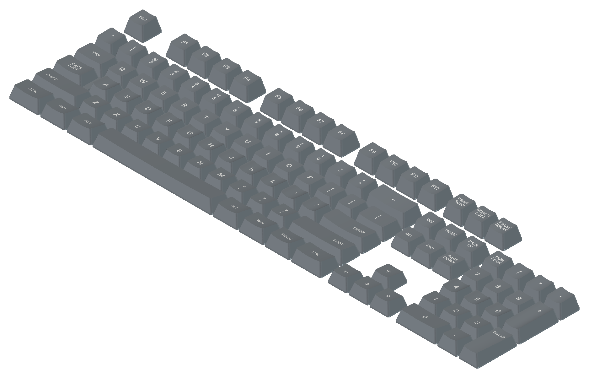
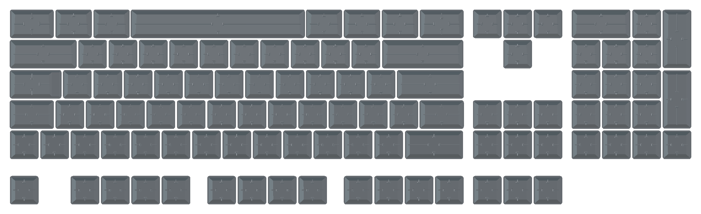

# Logitech G613 keycaps (3D-printable, parametric)

Replacement keycaps for the **Logitech G613** wireless mechanical keyboard (Romer-G switches),
as native, parametric FreeCAD models you can print, with two-colour legend inlays. The shapes
were reconstructed from caliper measurements of the original G613 keycaps: every row keeps its
own sculpted height, tilt and dish, and the caps keep the Romer-G four-block stem mount.





## Quick start

- **Print:** export the STLs (see [Export STLs](#workflows)), then print each key rim-down.
  For two colours, load a key's `NNN_<row>_<key>.stl` and `NNN_<row>_<key>_legend.stl` into
  the slicer as one multi-part object and give the legend its own filament.
- **Edit:** open `keyboard.FCStd` in FreeCAD 1.0+ (tested with 1.1). First point the
  `font_file` cell of `set.FCStd` at `fonts/Inter-SemiBold.ttf` in your copy of the repository.
  Then change any cell in the spreadsheets and recompute.

## Files

| File | Role |
|---|---|
| `keys_to_measure.csv` | Caliper measurements per key shape (source data) |
| `set_measurements.csv` | Measurements shared by the whole set: walls, stems, ribs (source data) |
| `layout.csv` | Every physical key: row, name, which measured shape it uses, grid position |
| `legends.csv` | Every key's legend: one or two lines, alignment, margin, size (source data) |
| `fonts/` | Legend font (Inter SemiBold, SIL Open Font License) |
| `build_native.py` | Builds the FreeCAD files from the CSVs, fitting each shape |
| `fit_profile.py` | Fits a FreeCAD keycap model to caliper measurements (used by `build_native.py`) |
| `export_stl.py` | Exports the cap and inlay STLs of every key from the FreeCAD files |
| `set.FCStd` | Spreadsheet `Set` with the values shared by all keys |
| `shapes/<id>.FCStd` | One parametric model per distinct key shape: spreadsheet `Params` + result object `Keycap` |
| `keys/NNN_<row>_<key>.FCStd` | One file per physical key: its shape with the legend inlaid; spreadsheet `Legend`, results `Cap` and `Inlay` |
| `keyboard.FCStd` | The whole keyboard: every key's `Cap` and `Inlay`, linked and placed on the layout |
| `fitted_shapes.csv` | Fit cache (generated) |
| `docs/` | The images above |
| `stl/` | Print files, `NNN_<row>_<key>.stl` + `NNN_<row>_<key>_legend.stl` (generated, not versioned) |

## How it fits together

```
keys_to_measure.csv ─┐
set_measurements.csv ├─► build_native.py ──► set.FCStd, shapes/*.FCStd, keys/*.FCStd, keyboard.FCStd
layout.csv ──────────┤   (fit_profile.py)    fitted_shapes.csv
legends.csv ─────────┘                               │
                                    keys/*.FCStd ─► export_stl.py ─► stl/*.stl
```

The FreeCAD files are the only definition of the geometry. They need neither Python nor
the scripts once generated: open them, edit a spreadsheet cell, recompute.

- `set.FCStd` holds set-wide values. Every shape's `Params` sheet reads them through
  cross-file references (`set#Set.wall`), so changing one there updates every key.
- Each `shapes/<id>.FCStd` holds the key's own values in `Params`, cells derived from them, and a
  model driven by expressions. The values are footprint, height, tilt, dish, the three wall
  slants, stem rotation, and the stepped-key values `body_w` and `step_height`. The model is
  built from Draft rectangle lofts, a tilted dish cylinder, the cavity cut, and PartDesign stems
  and ribs.
- Each `keys/NNN_<row>_<key>.FCStd` is one physical key. It links its shape's `Keycap`, and keys
  with the same shape share one shape file (for example, all letter keys of a row). It also
  inlays the key's legend:
  - Its `Legend` sheet holds the text and placement, and mirrors the shape's values.
  - The text is a Draft ShapeString extruded straight down and kept within `legend_depth` below
    the dish, so the inlay follows the curved top.
  - `Cap` is the keycap minus the inlay, and `Inlay` is the legend itself.
  - Keys without a legend (Space) only link the shape.
- `keyboard.FCStd` links every key's `Cap` and `Inlay` at its layout position. Opening it also
  opens the key, shape and set files.

## Workflows

**Edit the design in FreeCAD.** Open `keyboard.FCStd`, a shape file or a key file. Change cells in
`Set`, `Params` or `Legend`, recompute and save. Then export STLs. To change the font for the whole
set, put the font file in `fonts/` and point `Set.font_file` at it.

Do not rerun `build_native.py` afterwards: it regenerates the FreeCAD files from the CSVs and
overwrites such edits.

**Re-measure and regenerate.** Update the CSVs, then run `build_native.py` inside the FreeCAD
GUI's Python console:

```python
p = "/path/to/repo/build_native.py"; exec(open(p).read(), {"__file__": p})
```

It must run in the GUI: files saved by a headless FreeCAD open with every object hidden.
Shapes whose measurements and set values are unchanged come from `fitted_shapes.csv`. A full
regeneration then takes under 2 minutes, and a full refit of all 20 shapes about 5 more.

**Export STLs** (headless is fine):

```sh
freecadcmd -c "p = '/path/to/repo/export_stl.py'; exec(open(p).read(), {'__file__': p})"
```

STLs are meshed from the current FreeCAD files with 0.01 mm deflection, rim down on Z=0.

## Conventions

- Key frame: rim on Z=0, +Z up, X left-right, **-Y = back** (the edge nearest the user, at the
  bottom of the legend), +Y = front.
- **Width** is front-back, **length** is left-right.
- **Horizontal stems** are the pair beside each other left and right of the center. **Vertical
  stems** are the pair in front of and behind it. Left Ctrl, Right Ctrl and Caps Lock have the
  arrangement turned 90° (`stem_rotated = 1`).
- `tilt` > 0 raises the back. Rows R3–R6 have the back edge higher, R1–R2 the front edge.
- Layout positions are on a 19.05 mm grid: the G613's full-size ANSI layout, 104 keys, with its
  bottom row of 1.5u Ctrl, 1.25u Win/Alt/Menu and a 5.75u Space.

## Measurements

Per key shape (`keys_to_measure.csv`), with the key standing on its rim:

- `bottom_width_mm` / `bottom_length_mm`: footprint, on the straight band at the base.
- `front_min_mm` / `back_min_mm`: height at the middle of the top edge. Point the caliper jaw
  front-to-back so it touches only the middle.
- `front_max_mm` / `back_max_mm`: height at the corners, with the jaw laid along the edge. Only
  the higher edge's max is reliable; its max − min is the dish depth.
- `top_width_mm` / `top_length_mm`: top outline, measured across the middle.
- `step_body_length_mm` / `step_height_mm` (optional, stepped keys only):
  - The raised part's base length, flush with the left edge.
  - The height of the flat shelf that fills the rest of the footprint on the right.

  The raised part is fitted like a normal key, with the heights and top outline measured on it.
  The shelf is hollow, with a roof `top_thickness` thick. The stems are centered on the raised
  part.

The fit derives:
- the key's center height and tilt, from the two mins;
- the dish, from the higher edge's max − min;
- the side slant, from the top length;
- one shared front/back slant, from the top width.

Set-wide values (`set_measurements.csv`, column `key_1`): wall thickness, straight base height,
corner radius, stem sizes / gaps / tip heights, stem-tip-to-rib gaps, rib thickness, top
thickness.

## Legends

`legends.csv`, one row per key of `layout.csv`:

- `line1`, `line2`: the text. With two lines the legend is stacked, both lines centered.
- `align`, with `margin_mm`:
  - `center`: centered on the top. On a stepped key, centered on the raised part.
  - `left` or `right`: a fixed `margin_mm` from that side's top edge (Left Shift, Right Shift,
    Enter).
  - `top`: a fixed `margin_mm` from the front edge (Num Enter, Num +).
- `size_mm`: cap height of the text; blank uses `Set.legend_size` (3.6).

Set-wide legend values in `set.FCStd`:
- `font_file`
- `legend_size`
- `line_gap`: between the two lines of a stacked legend, 1.0
- `legend_depth`: inlay depth perpendicular to the dish, 0.4 of the 0.6 mm top

The font path is absolute: on another computer, point `Set.font_file` at the copy in `fonts/`.

### Parameters not measured

- `dish_sag` in `Params` is the dish dip at the end of the straight part of the higher top
  edge. It defines the dish exactly but reads slightly less than the caliper max − min.
- Set defaults in `build_native.py` (`SET_DEFAULTS`): base corner radius 1.5, stem fillet 0.35,
  rib fillet 0.25, and construction margins that do not change the shape.

## Known limits and estimates

- Only the 104 keys of the main layout are modeled. The G613's G1–G6 macro keys and media
  keys are not included.
- No stabilizer mounts on Backspace, Enter, Shifts, Space, Num 0, Num +, Num Enter: those keys
  have only the center stems.
- No homing bumps on F and J.
- Legends only on top, no front (side) legends.
- Estimated, not measured:
  - top thickness (0.6 mm)
  - Shift heights (set equal to Z/M)
  - Num + and Num Enter heights (continued from the neighboring numpad keys)
  - the stepped Caps Lock's raised-part base length (27.8 mm, taken from Tab)
- Caps Lock is a stepped key: a Tab-like raised part with the ASD row's profile, and a 2.6 mm
  shelf on the right. The shelf objects only exist in stepped shape files, so turning another
  key into a stepped one means regenerating it with the step columns filled in.
- Print fit on the Romer-G stems depends on your printer; test one key before printing the set.

## License

The models, data and scripts are released under the [MIT License](LICENSE). The Inter font in
`fonts/` is © The Inter Project Authors, under the SIL Open Font License 1.1
(`fonts/Inter-LICENSE.txt`).

## History

- Tag `script-v1`: the earlier version, where a Python model (`keycap.py`) generated plain
  solids and STLs. Its default values were reconstructed from a reference keycap STL.

Not affiliated with or endorsed by Logitech. "Logitech", "G613" and "Romer-G" are trademarks of
Logitech.
